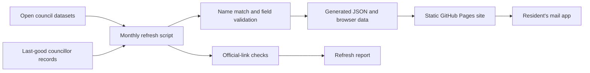

# Architecture

The site is static. Browser code reads the generated `data/councillors.js` object, lets a resident choose an area and issue, then builds a `mailto:` link for the resident's own mail app. The page does not need an application server to look up councillors or compose the message.

`data/sources.json` lists machine-readable datasets. `scripts/refresh.mjs` updates the fields configured for each source, checks profile and record links, and writes `data/councillors.json`, `data/councillors.js` and `ops/refresh-report.md`. Hand-curated fields such as `focus` are not sourced from the refresh dataset.

## Data coverage

The refresh source currently lists a Dublin City Council dataset. Its [publisher metadata](https://data.smartdublin.ie/dataset/councillor-detail-dcc) says it was last updated on 23 April 2025; an automated refresh can retrieve that dataset, but it cannot make its contents newer than the publisher's latest release. Dún Laoghaire–Rathdown has no machine-readable councillor dataset configured, so its records are retained and official links are checked.

## Privacy boundary

The static page composes an email locally in the browser. The resident reviews and sends it through their own mail provider. The scheduled workflow does contact the configured public data sources and council websites to refresh data and validate links.
